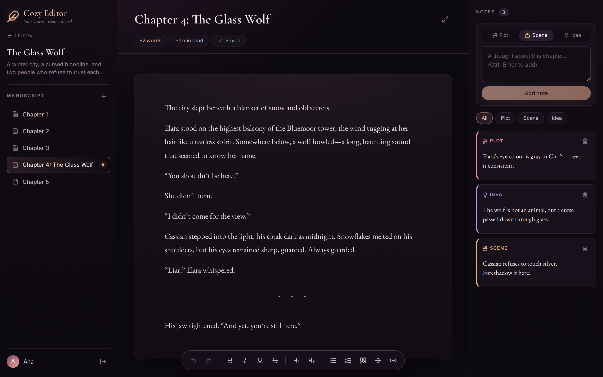
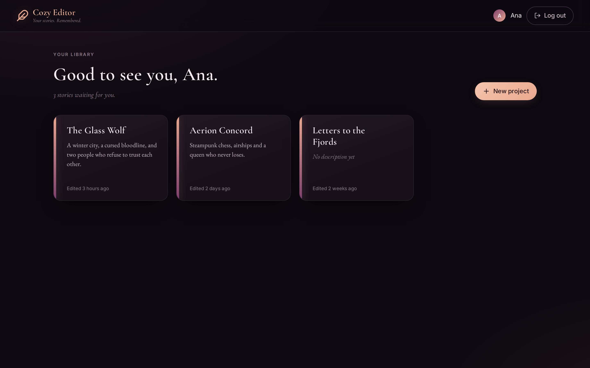
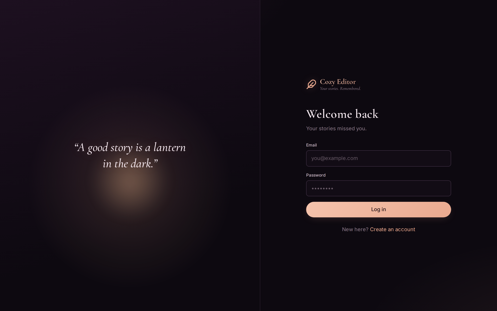
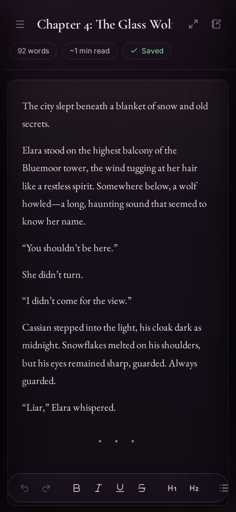

# Cozy Editor

A distraction-free writing app for long-form fiction. Organise stories into projects and chapters, write in a rich-text editor with autosave, and keep plot, scene and idea notes next to the text.

Live link: https://cozy-editor-six.vercel.app/



## Features

- **Rich-text editor** built on Tiptap: headings, lists, quotes, links, scene breaks, smart typography
- **Autosave**: debounced and serialized, retries after failures, `Ctrl+S` to save instantly, warns before closing with unsaved changes
- **Projects & chapters**: library view, chapter sidebar, inline renaming, optimistic deletes
- **Chapter notes**: typed as plot, scene or idea, with filters
- **Focus mode** and a live word count
- **Responsive**: sidebar and notes become drawers on smaller screens
- **Secure auth**: short-lived access tokens with rotating, single-use refresh tokens

| Library | Login | Mobile |
| --- | --- | --- |
|  |  |  |

## Tech stack

| | |
| --- | --- |
| **Frontend** | React 19, TypeScript, Vite, React Router, Tiptap, Axios, Sonner |
| **Backend** | Node.js, Express 5, TypeScript (ESM), Mongoose |
| **Data** | MongoDB (users, projects, chapters), Redis / Upstash (sessions) |
| **Security** | bcrypt, JWT, httpOnly cookies, Helmet, express-rate-limit |

## Authentication

```
Login ──► access token (JWT, ~15 min, kept in memory)
      └─► refresh token (httpOnly cookie, scoped to /api/auth, hashed in Redis)

Request ──401──► POST /api/auth/refresh ──► new access token + rotated refresh token
                                      └──► retry the original request
```

- **Rotation with reuse detection:** every refresh issues a new refresh token. Presenting an already-used token revokes the whole session.
- **Single-flight refresh:** concurrent `401`s share one refresh request, coordinated across browser tabs with the Web Locks API.
- **Session expiry handling:** if a refresh fails, the client clears its state and redirects to login.
- **Hardening:** rate-limited login and signup, constant-time token comparison, identical errors for unknown email and wrong password, input type checks against NoSQL injection, no internal error details in production.

## Project structure

```
backend/src
├── config/        env validation, MongoDB, Redis
├── controllers/   auth, projects, chapters
├── middleware/    auth, rate limiting, error handling
├── models/        User, Project, Chapter
├── routes/
└── utils/         ApiError, session & token helpers

frontend/src
├── api/           axios instance + interceptors, API modules
├── components/    Editor, Workspace, Project, shared UI
├── context/       auth state
├── hooks/         useAuth, useLogout, useChapterSaver
├── pages/         Auth, Project (library, workspace, chapter)
└── types/
```

## Getting started

**Requirements:** Node.js 20+, a MongoDB database, an Upstash Redis database.

```bash
# backend
cd backend
cp .env.example .env      # fill in your values
npm install
npm run dev               # http://localhost:5001

# frontend (second terminal)
cd frontend
cp .env.example .env
npm install
npm run dev               # http://localhost:5173
```

### Environment variables (backend)

| Variable | Description |
| --- | --- |
| `MONGO_URI` | MongoDB connection string |
| `UPSTASH_REDIS_REST_URL` / `UPSTASH_REDIS_REST_TOKEN` | Redis credentials |
| `ACCESS_TOKEN_SECRET` | Secret for signing access tokens |
| `ACCESS_TOKEN_EXPIRES` | Access token lifetime in **minutes** |
| `REFRESH_TOKEN_EXPIRES` | Refresh token lifetime in **days** |
| `CLIENT_URL` | Frontend origin, used for CORS |
| `COOKIE_SAME_SITE` | `lax` (default), `strict`, or `none` when client and API are on different sites |

## API

| Method | Endpoint | |
| --- | --- | --- |
| `POST` | `/api/auth/signup` · `/login` · `/logout` · `/refresh` | Authentication |
| `GET` | `/api/auth/me` | Current user |
| `GET` `POST` | `/api/projects` | List / create projects |
| `GET` `PATCH` `DELETE` | `/api/projects/:id` | Project with chapter list |
| `POST` | `/api/projects/:id/chapters` | Create chapter |
| `GET` `PATCH` `DELETE` | `/api/projects/:id/chapters/:chapterId` | Chapter content and notes |
